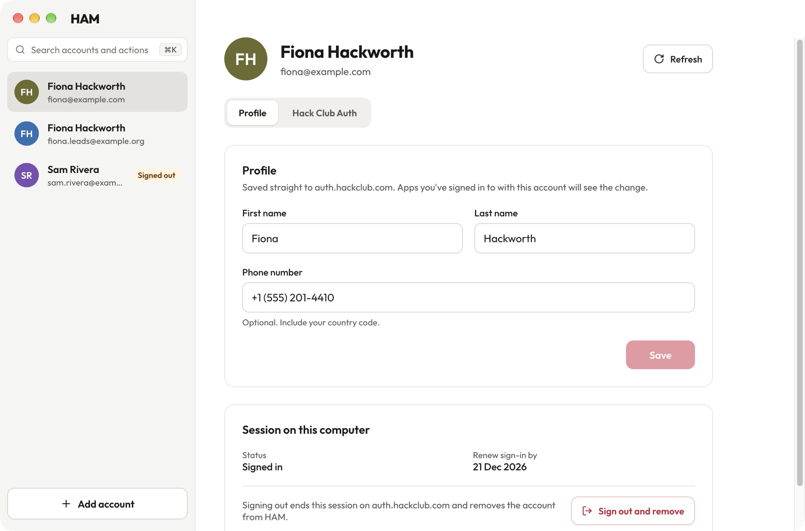
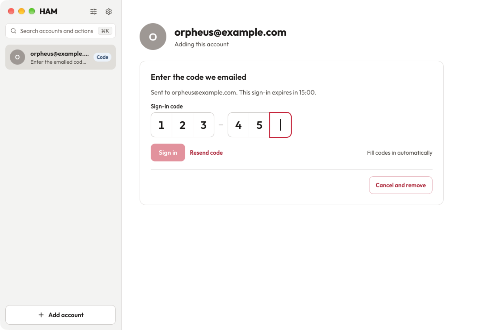
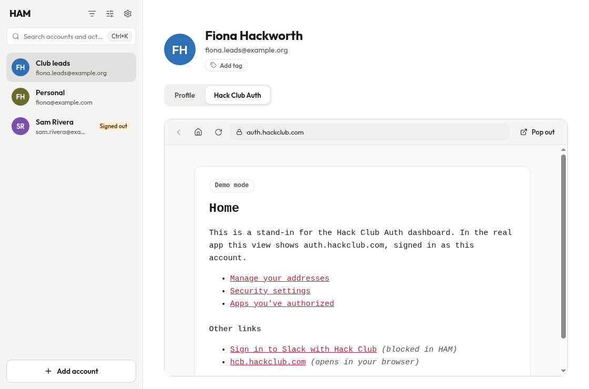
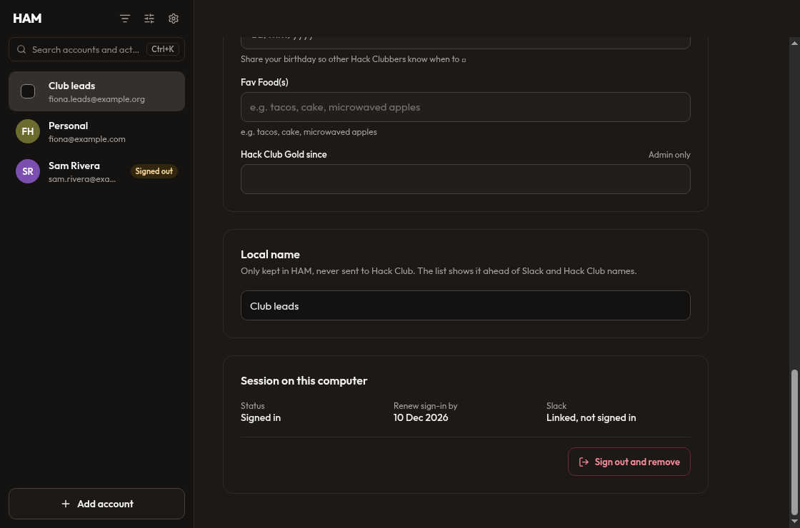
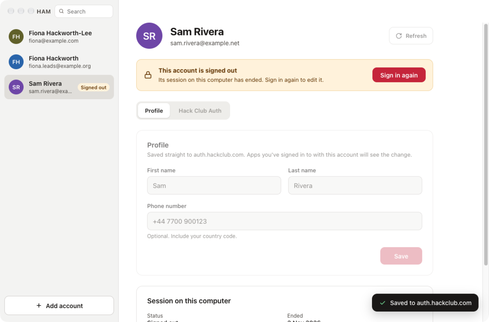

<h1 align="center">
  <picture>
    <source media="(prefers-color-scheme: dark)" srcset="build/wordmark-dark.png">
    
  </picture>
</h1>

<p align="center">Hack Club Account Manager: all your Hack Club accounts in one desktop app.</p>



HAM signs in to [Hack Club Auth](https://auth.hackclub.com) with your email, keeps each account signed in on its own, and lets you change the name and phone number on each one. It runs on macOS, Windows and Linux.

## Features

- **Add accounts by email.** HAM sends you a code, then asks for an authenticator or backup code if the account uses two-factor. Passkeys are always skipped.
- **Every account in one list**, with a "Signed out" badge when a session has ended.
- **A command palette** (Cmd+K) to jump to any account or run an action.
- **Edit name and phone number.** Changes save straight to auth.hackclub.com.
- **The Hack Club Auth dashboard, embedded** for each account and already signed in, or popped out into its own window. It's locked to auth.hackclub.com: it can't be used to sign in to other apps, and other links open in your browser.
- **Light and dark** themes that follow your system, plus keyboard shortcuts.

| | |
| --- | --- |
|  |  |
|  |  |

## Install

Download the latest build from [Releases](https://github.com/ingoau/ham/releases). The builds aren't code-signed yet:

- **macOS:** open HAM once, then go to System Settings › Privacy & Security and click **Open Anyway**. Or run `xattr -dr com.apple.quarantine /Applications/HAM.app`.
- **Windows:** in the SmartScreen dialog, click **More info › Run anyway**.
- **Linux:** `chmod +x HAM-*.AppImage`, then run it.

## Keyboard shortcuts

Cmd on macOS, Ctrl on Windows and Linux.

| Shortcut | Action |
| --- | --- |
| Cmd+N | Add account |
| Cmd+K or Cmd+F | Command palette: find an account or run an action |
| Cmd+S | Save profile |
| Esc | Revert unsaved changes, or close a dialog |
| Cmd+R | Refresh the account (or reload the dashboard) |
| Cmd+1 to Cmd+9 | Switch to account 1 to 9 |
| Up / Down | Move through the account list |
| Cmd+Shift+D | Switch between Profile and Hack Club Auth |

## How it works

Hack Club Auth has no API for editing a profile, so HAM uses the same form endpoints as the website. The maintainers approved this.

- **One cookie partition per account** (`persist:acct-<uuid>`). Electron keeps each account's session cookies there, encrypted with the OS keychain (the `enableCookieEncryption` fuse). HAM itself never stores cookies, codes or tokens. Its `accounts.json` holds only emails, cached names and phone numbers, and session expiry dates.
- **The main process makes every request** with `net.request` in the account's partition. The renderer only talks to it over typed IPC.
- **Sign-in:** `POST /login`, `/login/:id/verify`, `/totp` and `/backup_code`, following the server's redirects by hand. Passkey prompts are skipped through `/login/:id/webauthn/skip`.
- **Profiles:** read from `/identity/edit` and saved with `PATCH /identity` plus the Rails CSRF token. All HTML parsing lives in [`src/main/auth/pages.ts`](src/main/auth/pages.ts) and is tested against saved fixtures.
- **Dashboard:** a sandboxed `WebContentsView`. [`src/main/lockdown.ts`](src/main/lockdown.ts) blocks pages on other hosts and the SSO paths `/oauth/authorize` and `/saml/*`.

## Development

HAM uses [pnpm](https://pnpm.io) (the version is pinned in `package.json`).

```sh
pnpm install
pnpm dev             # run the app with hot reload
HAM_MOCK=1 HAM_MOCK_SEED=1 pnpm dev   # demo mode: a fake server with sample accounts
pnpm typecheck
pnpm test            # unit tests (parsers, lockdown rules, versions)
pnpm build && node scripts/smoke.mjs  # UI smoke test in demo mode
pnpm screenshots     # regenerate docs/screenshots (demo mode)
pnpm dist            # package for the current platform into dist/
```

In demo mode:

- an email containing `new` has no account
- `2fa…` asks for an authenticator code
- `passkey…` needs a passkey as the only second factor
- the code `000000` is always wrong

`scripts/real-signin.mjs` runs the same checks against the real auth.hackclub.com with a test account (`HAM_TEST_EMAIL=… node scripts/real-signin.mjs`, then write the emailed code to `.screenshots-tmp/code.txt`).

## Releasing

1. Bump `version` in `package.json` and commit.
2. Tag and push: `git tag v0.2.0 && git push origin v0.2.0`.

The [Release workflow](.github/workflows/release.yml) builds every platform, attaches the installers to a GitHub Release and publishes it. [CI](.github/workflows/ci.yml) typechecks, tests and smoke-tests every push, and packages all three platforms on `main`.

## Brand

The logo is the wordmark "HAM" in [Outfit](https://fonts.google.com/specimen/Outfit) ExtraBold (800) with -0.04em letter-spacing: ink `#1c1917` on light, white on dark. The app icon is the wordmark in white on an ink rounded square, cut down to "H" at 32 px and below. `pnpm icons` regenerates every icon and the README wordmark from it. Outfit is also the UI font. It's bundled with the app and licensed under the SIL Open Font License.

## License

[MIT](LICENSE)
